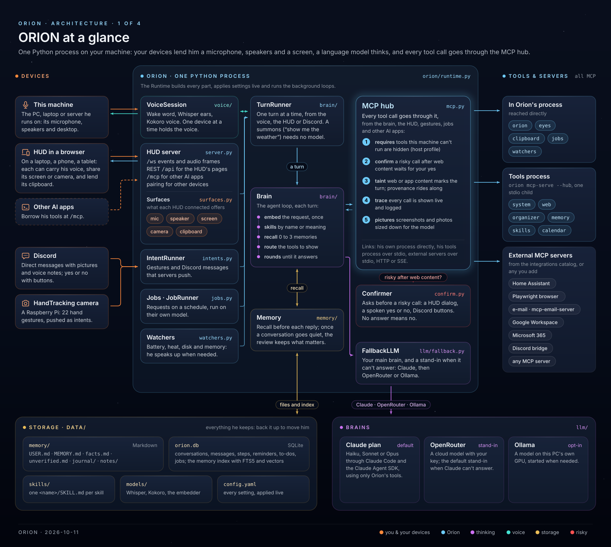

# ORION

[](https://github.com/ToniLabInc/Orion/actions/workflows/ci.yml)
[](LICENSE)

A personal voice assistant that runs on your own machine: a Linux desktop or laptop, a server, or Docker anywhere.
Say **"Orion"** and talk to him: he answers aloud, keeps listening while the conversation goes on, controls the
machine, sees your screen when you ask, searches the web, remembers what you tell him, runs your routines and
scheduled jobs, and reaches you on Discord. A HUD in the browser (<http://localhost:8765>) shows him, the
conversation and whatever you ask for, and any browser you open it in (a laptop, a phone) can be his microphone,
speakers, eyes and clipboard.

He is built so that no model, his own brain included, can abuse the access he has: your keys live in a vault he
cannot read, his commands run in a sandbox, and every channel has limits that no "yes" overrides
([how](docs/SECURITY.md)).

He thinks with your **Claude plan** by default (through Claude Code), or with a model on your own GPU (Ollama), or
with a cloud model through OpenRouter, and another brain stands in when one can't answer. His ears (Whisper), his
voice (Kokoro) and his memory search always run on his own machine.



## What he can do

| | |
|---|---|
| **Voice** | wakes on his name, even mid-sentence ("…what time is it, Orion?"); keeps listening after he answers; can be interrupted, on speakers too (echo cancellation); from this machine's microphone, or from any browser's (the HUD's talk button) |
| **Instant** | timers, the time, volume, media, lights and your lists are done in a few milliseconds without the model, so they work even when his brain is down; anything else goes to the brain |
| **The machine** | open apps, sites, files and folders · run commands (in a sandbox) · read and write files · volume and media · lock, sleep, restart, shut down · what's using it; only what this machine can do is offered (a server has no volume) |
| **Eyes** | looks at your screen or camera when you ask ("what's this error?"): what a HUD shares, or this machine's own screen; and your clipboard |
| **Internet** | web search, reading pages, news, weather (DuckDuckGo and Open-Meteo, no keys) |
| **Memory** | remembers facts about you in Markdown files, recalls what's relevant before he answers, reviews each conversation on his own |
| **Skills** | routines in the `SKILL.md` format; he learns new ones when you teach him ("when I say movie night, …") |
| **Organizer** | timers, reminders (spoken aloud, even after a restart), a to-do list, and your calendars (CalDAV or an iCal link: any provider) |
| **Jobs** | requests he runs on his own at the times you set ("every weekday at 7:30, brief me"), on the brain you choose for them |
| **Watchers** | he speaks up when the machine needs you: battery low, running hot, disk or memory nearly full |
| **Documents** | point him at a folder (or an Obsidian vault): PDF, Word, PowerPoint, Excel, Markdown, … are read once and searched by keyword and meaning; he answers from them |
| **Connectors** | everything that gives him tools, in one place (Customize): his own, Home Assistant, a browser he drives, e-mail, Google Workspace, Microsoft 365, Notion, Linear, Slack and more, each with its own settings and sign-in |
| **Plugins** | Claude's plugin format: install from Anthropic's directory or upload one; he uses its skills and connectors and never runs its hooks |
| **Safety** | keys in a vault, commands in a sandbox, per-channel limits (never `run_command` from Discord, say), a question before anything risky after untrusted content, and a log of everything he did |
| **Backups** | a nightly archive of his memory and settings, optionally copied off the machine with restic (`orion backup`, `orion restore`) |
| **Brains** | your Claude plan, a model on this PC, or OpenRouter (with a daily budget); a stand-in when one can't answer; `orion bench` scores them on picking his tools |
| **Gestures** | with the [HandTracking](https://github.com/ToniLabInc/HandTracking) camera on a Raspberry Pi: 22 hand gestures, each doing what you choose (on that connector's page) |
| **MCP** | every tool is an MCP server: his own, and any you add. He lends his tools to other AI apps too |

How it fits together, drawn: [at a glance](docs/architecture/overview.svg) ·
[the life of a request](docs/architecture/request.svg) · [runs anywhere](docs/architecture/everywhere.svg) ·
[security](docs/architecture/security.svg) (PNGs beside them; the first three describe him as he was before connectors,
the vault and instant commands: [SECURITY.md](docs/SECURITY.md) is current).

## Install

Natively: Linux (built and tested on Ubuntu with GNOME, PipeWire, systemd; other desktops and sound servers work, and
without a desktop he simply doesn't offer what needs one). Anywhere else, or on a server: Docker
([docker/README.md](docker/README.md)), with the HUD in your browser as his microphone and speakers. An NVIDIA GPU is
recommended for speech recognition, not required. About 4 GB of disk. His commands run in a sandbox, which needs
bubblewrap (already on most desktops; otherwise `sudo apt install bubblewrap`: `orion check` says), and `restic` only
if you want backups copied off the machine.

```bash
git clone https://github.com/ToniLabInc/Orion.git && cd Orion
./install.sh                     # uv, the Python libraries, the models, the `orion` command and an app-menu entry
curl -fsSL https://claude.ai/install.sh | bash && claude   # Claude Code, signed in with your Pro or Max plan
orion check                      # says what's missing, and how to fix it
```

`./install.sh --local-brain` also installs Ollama (to think on this PC), `--autostart` starts him on login,
`--uninstall` removes what the installer added outside the folder. Or run him in Docker: [docker/README.md](docker/README.md).

## Using him

```bash
orion start [--open]     # start in the background (and open the HUD); the app menu's ORION does the same
orion stop               # stop, freeing the GPU and the microphone
orion restart · orion status
orion run [--no-voice]   # run in this terminal, with the logs (orion -v run for debug logs)
orion check              # diagnose the installation
orion memory reset       # forget everything he has learned
orion secret set NAME    # keep a key, token or password in his vault (also: list, delete)
orion backup [--list]    # back up now · orion restore latest (while he is stopped)
orion bench              # score the brains on picking his tools, in a dry run
```

Things to say: "What's the weather tomorrow?" · "Set a timer for 12 minutes." · "Remind me at 9 to call the
dentist." · "What's on my calendar tomorrow?" · "Every weekday at 7:30, brief me." · "What does my report say about Q3?" · "What's this error on my
screen?" · "Open Firefox." · "Why is my PC slow?" · "Show me the vitals." · "Think with Opus." · "Stop."

After an answer he keeps listening for 15 seconds, so you can follow up without his name; "thanks" or "that's all"
ends it. Typing works too: start typing anywhere in the HUD.

## The HUD

Orion himself is the **horizon**: the night side of a world seen from orbit under the real sky, with the constellation
Orion in it. A thin line of light along the edge is his voice (blue at rest, orange while he listens, teal while he
speaks, and it vibrates with the sound); aurora rises from it while he thinks; a meteor streaks to a card when a tool
fills it; short answers (the time, a temperature, a timer) are written in light.

The conversation shows every step he takes; the composer takes text, pasted or dropped pictures, a shared screen or
camera and the talk button; chips in the top bar count running timers, questions waiting for your yes and alerts;
cards come when you ask ("Orion, show me the weather", "show me today"). Ctrl+K (⌘K) finds anything; Esc stops him
while he works, else sends the newest card away.

Pages: **Memory** (his memory as a 3D map), **Automations** (jobs and watchers), **Customize** (connectors, skills and
plugins, each with its own page), **Activity** (everything he did and who allowed it) and **Settings** (his own
options, saved as you change them). On a phone the sky sits on top and the talk button is big. From a phone or tablet:
Settings → Devices → "Your network too", then pair the device with the code shown on the PC.

## The brain

Settings → Brain, or just ask ("think on this PC"). No restart.

- **Your Claude plan** (default): Haiku, Sonnet or Opus through Claude Code, using your plan's limits. Claude Code's
  own tools are switched off for the conversation: Claude uses only Orion's tools.
- **This PC**: Ollama with a model that uses tools (`qwen3.5:4b` fits a 6 GB GPU). Needs `./install.sh --local-brain`.
- **OpenRouter**: paste a key from openrouter.ai/keys; `:free` models cost nothing. `openrouter.daily_budget_usd` caps
  a day's spending: past it the stand-in answers instead and the HUD says why.
- **The stand-in** (`brain.fallback`, OpenRouter by default): when the brain can't answer (your plan's usage limit,
  signed out, not running), it answers the same request at once and he says so; the main brain is tried again after
  half an hour.
- **Jobs** think with `jobs.provider`: the same brain, or a cheaper one so scheduled work doesn't use your plan.
- **Test and measure**: `brain.provider: script` replays a script instead of a model (to try the safety question or
  the stand-in for free: `script.path`); `orion bench [--brain …] [--suite builtin|history]` scores brains on his
  tools without running any; Settings → Brain shows what each stage of a request takes.

## Memory, connectors and security

- **Memory** lives in `data/memory/`: `USER.md` (facts about you), `MEMORY.md` (his notes), `facts.md`,
  `unverified.md` (what he read somewhere, until you confirm it), `journal/` and `notes/`. Edit the files whenever you
  like; he picks the changes up. On the memory map you can read, confirm or forget any memory.
- **Documents**: Customize → Connectors → Documents: choose folders; he indexes them in the background (PDF, Word,
  PowerPoint and Excel are converted in a sandboxed worker, with no network) and searches them by keyword and meaning.
  What he reads there is untrusted content, like a web page.
- **Skills** are folders with a `SKILL.md` (the open Agent Skills format). Yours, the ones he learned and a plugin's
  are under Customize → Skills; Discover offers Anthropic's examples. Teach him by voice too.
- **Connectors**: Customize → Connectors lists everything that gives him tools: his own groups, ready-made ones (Home
  Assistant, a browser, e-mail, Google, Microsoft, Notion, Linear, Slack, …) set up from a few fields or a sign-in,
  plugins' servers, and your own (a command or a URL). Each has its page: status, tools (a switch per tool, and why one
  isn't offered on this machine), settings, which secrets it uses, its activity. Or in `data/config.yaml`:

  ```yaml
  mcp_servers:
    home-assistant:
      url: http://homeassistant.local:8123/api/mcp
      headers: {Authorization: "Bearer ${secret:connector.home-assistant.token}"}   # the vault's, never the token itself
  ```

- **Plugins**: Customize → Plugins → Discover lists Anthropic's directory (the first start fetches it from GitHub, then
  he looks for changes hourly; empty `plugins.marketplaces` and `skills.sources` to never). Installing a plugin only
  unpacks it; its skills and connectors are used, its hooks and agents never run. Connectors from plugins nobody
  reviewed run in the sandbox.
- **Other AI apps** can use his tools while he runs: `claude mcp add --transport http orion http://127.0.0.1:8765/mcp`.
  While he's stopped, `orion mcp-serve` lends them over stdio.

He has full access, kept in check by things no model can switch off ([the design](docs/SECURITY.md), drawn in
[security](docs/architecture/security.svg)):

- **Keys never reach a model.** Keys, tokens and passwords live in the vault (your desktop's keyring, or private files
  on a server: `secrets.store`), and `config.yaml` only says `${secret:NAME}`. Anything a model, a log, the HUD or
  Discord receives is scrubbed of every known secret; a tool call carrying one is refused.
- **Commands run in a sandbox**: the PC read-only, your keys, browser profiles and his own data hidden, a clean
  environment, no desktop. Running outside it asks you every time.
- **Channel limits**: for each place a request comes from (voice, HUD, Discord, jobs, other apps) what he may never do
  and what he always asks about (Discord can never run commands, for example).
- **A question after untrusted content**: once a request has read a web page, an e-mail, a document or another app's
  content, anything that changes or sends something waits for your yes (in the HUD, aloud, or on Discord; no answer
  means no).
- **He can't loosen any of it**: safety, sandbox, secrets and channel settings are yours alone, and adding or
  removing a connector or plugin always asks you. Everything he does lands in Activity.

## Settings

Everything is in `data/config.yaml`, which the HUD's Settings edits too: every option, each with a one-line
explanation and your value. Edit it by hand whenever you like; he reloads it the moment you save it (options marked
`[restart]` apply after a restart), and a value you never changed follows the default in `orion/default_config.yaml`
when an update improves it.

## Privacy

Your voice, his memory and its search, your conversations, reminders, jobs and to-dos stay on his machine (a browser
carrying his voice streams it to him and back, over your own connection). What goes out: web searches and pages you
ask for, the weather (your city), model downloads, Anthropic's plugin directory and skill examples (from GitHub, see
Plugins), your conversation if he thinks with your Claude plan or OpenRouter, what you send him on Discord and his
answers there, a backup if you give restic a repository elsewhere, and whatever connectors you add do. Your documents
are read on this machine only. His logs hold no conversation text unless you switch it on (Settings → Memory).
A hand-gesture camera ([HandTracking](https://github.com/ToniLabInc/HandTracking)) gives him gestures; its picture
reaches the HUD only if you turn it on in the HANDS view, and he doesn't keep it. `data/` is everything he keeps (not
the vault: `orion secret set` again on a new machine); `orion backup` makes the archive to move him to another PC.

## Development

```bash
uv run pytest                                         # the Python tests (about 1,240, a minute)
uvx ruff check orion tests                            # lint
uv run --only-group web npm --prefix web ci           # the HUD's packages (Node comes from uv)
uv run --only-group web npm --prefix web run dev      # the HUD live on :5173, against a running Orion
uv run --only-group web npm --prefix web test         # the HUD's tests (Vitest)
uv run --only-group web npm --prefix web run build    # typecheck and build into orion/hud/dist (commit it)
```

| | |
|---|---|
| `orion/runtime.py` | starts everything and applies settings live |
| `orion/brain/`, `orion/llm/` | the agent loop, the three brains and the stand-in (`llm/fallback.py`) |
| `orion/voice/` | microphone, wake word, Whisper, Kokoro, the conversation window; a browser's mic and speakers |
| `orion/instant.py`, `orion/timing.py` | the commands done without the model, and the time each stage of a request takes |
| `orion/surfaces.py`, `orion/host.py` | the devices you use him from, and what this machine has (which tools exist here) |
| `orion/secrets.py`, `orion/redact.py`, `orion/sandbox.py` | the vault, the scrubbing of secrets, the bubblewrap jail ([SECURITY.md](docs/SECURITY.md)) |
| `orion/confirm.py`, `orion/activity.py` | asking you before a risky action, and the log of what he did |
| `orion/jobs.py`, `orion/watchers.py` | scheduled jobs, and the warnings about the machine |
| `orion/connectors.py`, `plugins.py`, `oauth.py`, `catalog.py`, `skills.py` | connectors, plugins and skills (Customize), sign-ins, the ready-made list |
| `orion/discord_bridge.py` | the Discord bot (`orion discord-serve`) |
| `orion/backup.py`, `orion/documents.py` | backups and restore, the documents' index and search |
| `orion/spend.py`, `orion/bench.py`, `orion/llm/script.py` | OpenRouter's cost and budget, the brain benchmark, the scripted brain |
| `orion/memory/` | the Markdown memory, its SQLite index and the review |
| `orion/mcp.py` | the hub every tool call goes through (limits, confirmation, scrubbing, the log); `/mcp` for other apps |
| `orion/tools/` | his built-in tools (`system`, `web`, `organizer`, `memory`, `skills`, `calendar`, `documents`), his controls (`core.py`), the eyes and clipboard (`device.py`), jobs and watchers (`automation.py`) |
| `orion/server.py` | the HUD's server: REST, the live WebSocket, pairing |
| `orion/config.py`, `default_config.yaml` | every setting, its type, range and who may change it |
| `web/` | the HUD (React, Vite, Tailwind); [web/README.md](web/README.md) |

Adding a tool: a function in one of `orion/tools/*.py` under `@group.tool(...)`; its docstring and type hints become
its MCP description and schema.

## Troubleshooting

| Problem | Fix |
|---|---|
| Something isn't working | `orion check` |
| He doesn't hear you | watch for "Hearing you…" in the dock; check the microphone in Settings → Voice; `orion -v run` logs every name check |
| He mishears | Settings → Voice → Ears should say large-v3-turbo on the GPU; names in his memory are recognised better |
| "Claude Code isn't signed in" | run `claude` and sign in, or switch to THIS PC |
| "no keyring answers" | on a server or in Docker set `secrets.store: files` (Docker does it for you) |
| A command says it can't run | `orion check` says whether this machine can make the sandbox (bubblewrap) |
| A tool fails | its connector's page (Customize → Connectors) shows the error and RECONNECT; Activity shows the call; logs are in `data/logs/` |
| The HUD looks wrong after an update | reload with Ctrl+Shift+R |
| Logs | `journalctl --user -u orion -f`, or `orion run` |

## Updating and uninstalling

```bash
git pull && ./install.sh && orion restart     # your data/ and settings stay
./install.sh --uninstall                      # then delete the folder (data/ holds his memory and models)
```

## Contributing and security

Bug reports, ideas and pull requests are welcome: [CONTRIBUTING.md](CONTRIBUTING.md) says how to set up, what CI
checks and what to know before touching the safety code, and everyone taking part follows the
[Code of Conduct](CODE_OF_CONDUCT.md). To report a vulnerability, privately, see [SECURITY.md](SECURITY.md); how the
safety design works is in [docs/SECURITY.md](docs/SECURITY.md). What changed between versions is in
[CHANGELOG.md](CHANGELOG.md).

## Licences

Orion's own code is MIT (see `LICENSE`). It is built on the Claude Agent SDK and Claude Code (with your own Claude
plan), Ollama and Qwen (optional), OpenRouter (optional), the MCP Python SDK, faster-whisper with Whisper and Silero
VAD, Kokoro-82M via kokoro-onnx with eSpeak NG (GPL 3.0), model2vec with potion-retrieval-32M, openWakeWord
(optional), ddgs, Trafilatura, dateparser, Open-Meteo, FastAPI, Uvicorn, httpx, pydantic, ruamel.yaml, psutil,
watchfiles, Pillow, mss, pyperclip, cronsim, caldav, icalendar, recurring-ical-events and x-wr-timezone (LGPL 3.0),
discord.py, keyring, google-re2, hassil and home-assistant-intents, LiveKit's audio processing, markitdown with
pdfminer.six, python-docx, python-pptx and openpyxl, bubblewrap (run as a program, LGPL), and the connectors' own servers (Playwright MCP, mcp-email-server, workspace-mcp, ms-365-mcp-server),
fetched when you set them up; the HUD on React, Vite, Tailwind CSS, Base UI, Motion, Anime.js, Lenis, visx, three.js
with react-force-graph-3d, zustand, TanStack Query, wouter, partysocket, react-markdown with remark-gfm
and remend (Apache 2.0), cn and Lucide icons (ISC), with the Geist, Geist Mono and Instrument Serif fonts (SIL OFL).
Horizon's sky is drawn from the Bright Star Catalogue, 5th Revised Ed. (Hoffleit D., Warren Jr W.H., Astronomical Data
Center, NSSDC/ADC, 1991), from the CDS, Strasbourg (VizieR V/50). Each keeps its own licence (MIT, Apache 2.0 or BSD
unless noted). A few of what `./install.sh` or the Docker image fetches are not permissive and are installed beside
Orion, not part of it: eSpeak NG and phonemizer (GPL 3.0, through kokoro-onnx), icalendar-searcher (AGPL 3.0, through
caldav, which is itself GPL 3.0 or Apache 2.0) and NVIDIA's cuBLAS (NVIDIA's licence; installed on x86-64 Linux, and in the GPU image). If you
redistribute a built image, their terms apply to it. The notices for what the HUD's build carries (fonts, packages) are in
[THIRD_PARTY_NOTICES.md](THIRD_PARTY_NOTICES.md).
